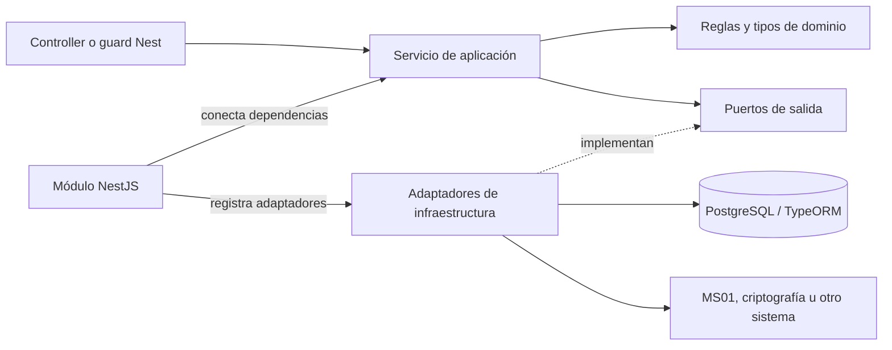

# Arquitectura hexagonal de `ms-auth` y `ms-catalog`

Los dos servicios separan el transporte y la infraestructura de las reglas y casos de uso. Para añadir un flujo, mantén la lógica de negocio en `domain` y `application`, define un puerto cuando el caso de uso necesite algo externo y conecta su adaptador desde el módulo NestJS.

## Camino de una solicitud



Las dependencias del código apuntan hacia adentro: los casos de uso conocen interfaces; los adaptadores implementan esas interfaces. Domain y application no importan NestJS, Express, TypeORM ni SQL.

## Dónde va cada cambio

| Capa | `ms-auth` | `ms-catalog` |
| --- | --- | --- |
| Borde HTTP | `identity.controller.ts`, `admin-review.controller.ts`, `sessions/session.controller.ts`, `session-auth.guard.ts` | `catalog.controller.ts`, `auth/catalog-admin.guard.ts` |
| Domain | `identity/domain/`, `sessions/domain/` | `catalog/domain/` |
| Application | `identity/application/`, `sessions/application/` | `catalog/application/` |
| Infrastructure | `identity/infrastructure/`, `sessions/infrastructure/` | `catalog/infrastructure/`, `auth/ms01-auth-client.ts` |
| Composición Nest | `identity.module.ts`, `sessions/session.module.ts` | `catalog.module.ts` |

Los controllers convierten HTTP en llamadas a casos de uso y dejan en el borde la lectura de parámetros, cookies, guards y formato de respuestas. Los filtros traducen errores de aplicación a los mismos códigos y cuerpos HTTP existentes.

Los puertos describen necesidades concretas de application. Ejemplos: `IdentityRepository`, `SessionRepository`, `SessionTokenService`, `CatalogRepository` y `CatalogAuthPort`. Los módulos registran las implementaciones con tokens para que cambiar PostgreSQL, HMAC o el cliente HTTP no cambie el caso de uso.

## Reglas para extender los servicios

| Principio | Aplicación en estos servicios |
| --- | --- |
| Responsabilidad única | Controllers, casos de uso, reglas y adaptadores tienen trabajos separados. |
| Abierto/cerrado | Un adaptador nuevo se conecta mediante un puerto sin reescribir el caso de uso. |
| Sustitución de Liskov | Un adaptador puede sustituir a otro si cumple el contrato del puerto y sus errores. |
| Segregación de interfaces | Mantén los puertos pequeños y limitados a lo que usa cada flujo. |
| Inversión de dependencias | Application depende de tipos de puerto; TypeORM y HTTP dependen hacia dentro de esos contratos. |

No añadas interfaces para clases puras que no crucen un límite. Conserva las transacciones y reglas de consistencia junto al adaptador de persistencia que las ejecuta; modela la política de negocio en domain/application.

## Verificación

Desde la carpeta de cada servicio:

```sh
pnpm exec vitest run <archivo-de-prueba>
pnpm test
pnpm build
pnpm lint
```

Los tests focalizados de domain/application pueden usar fakes para los puertos. Las suites `*.spec.ts` de integración necesitan PostgreSQL local y las variables del servicio exportadas al proceso desde `.env`; no imprimas ni copies secretos a comandos compartidos o documentación.

### Flujo recomendado para un caso de uso

1. Escribe una prueba de application que exprese el resultado y la interacción con su puerto; observa que falle por una aserción.
2. Implementa la regla/servicio y conserva el test en verde.
3. Añade o ajusta el adaptador y el wiring del módulo; verifica el contrato con pruebas focalizadas e integración cuando PostgreSQL esté disponible.
4. Comprueba que domain/application sigan sin imports de frameworks o infraestructura.
